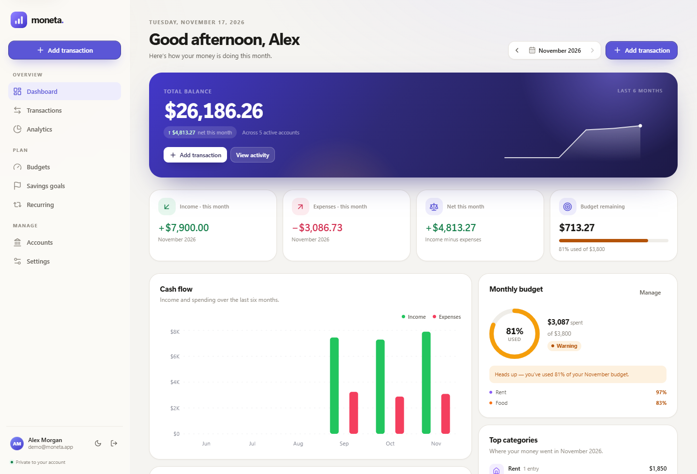
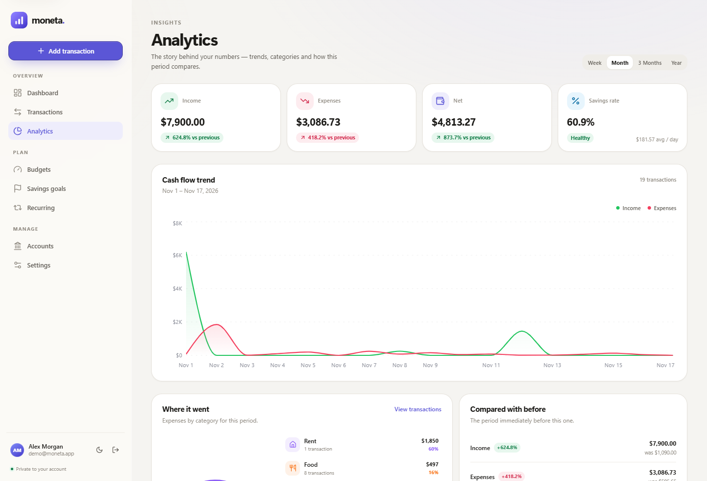
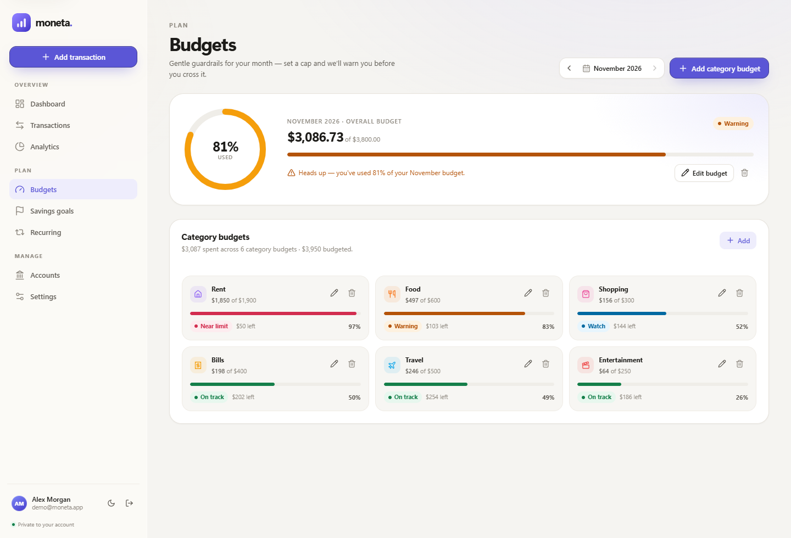
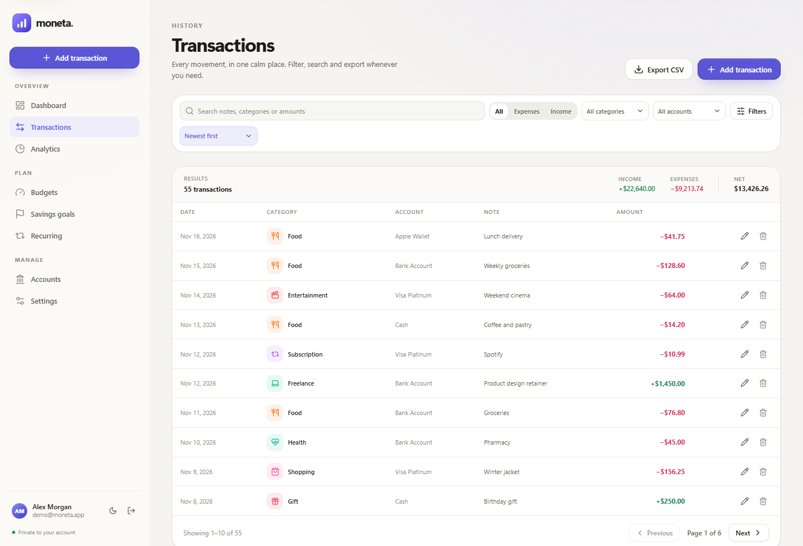
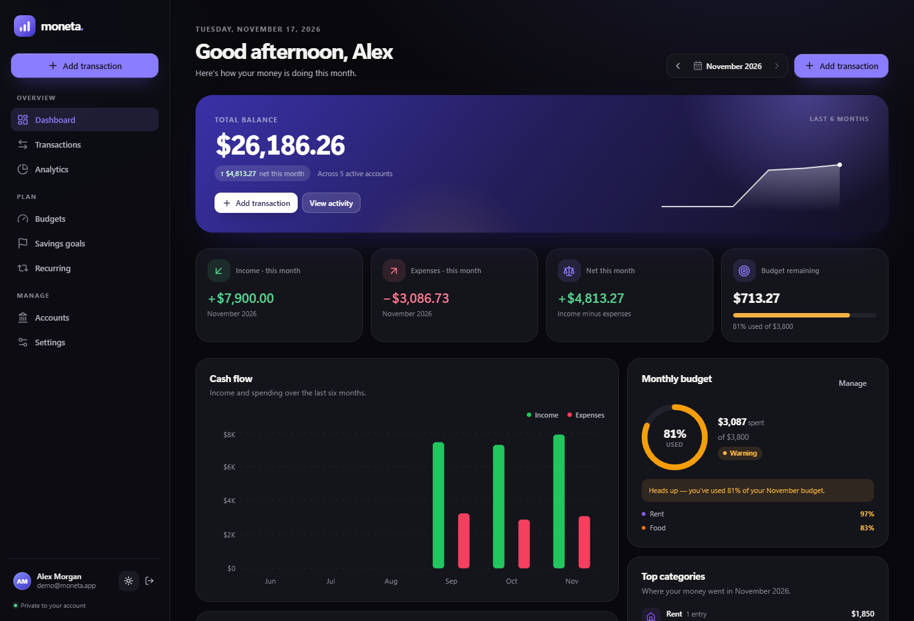
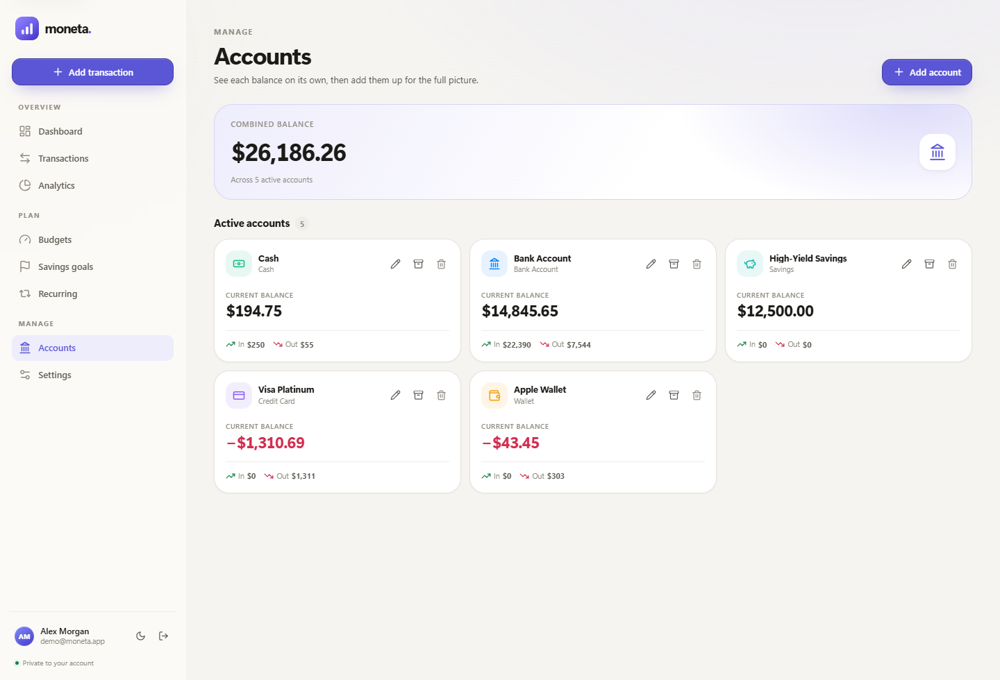
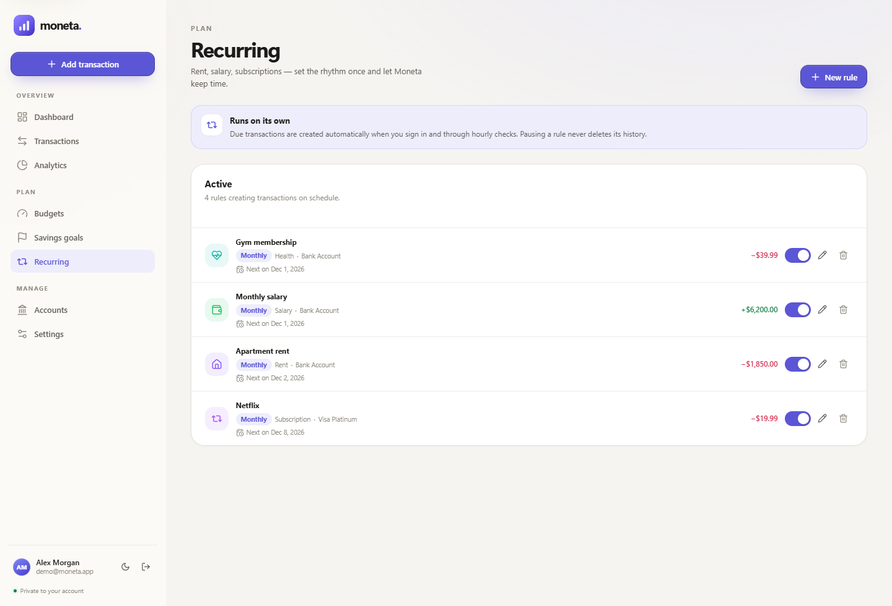
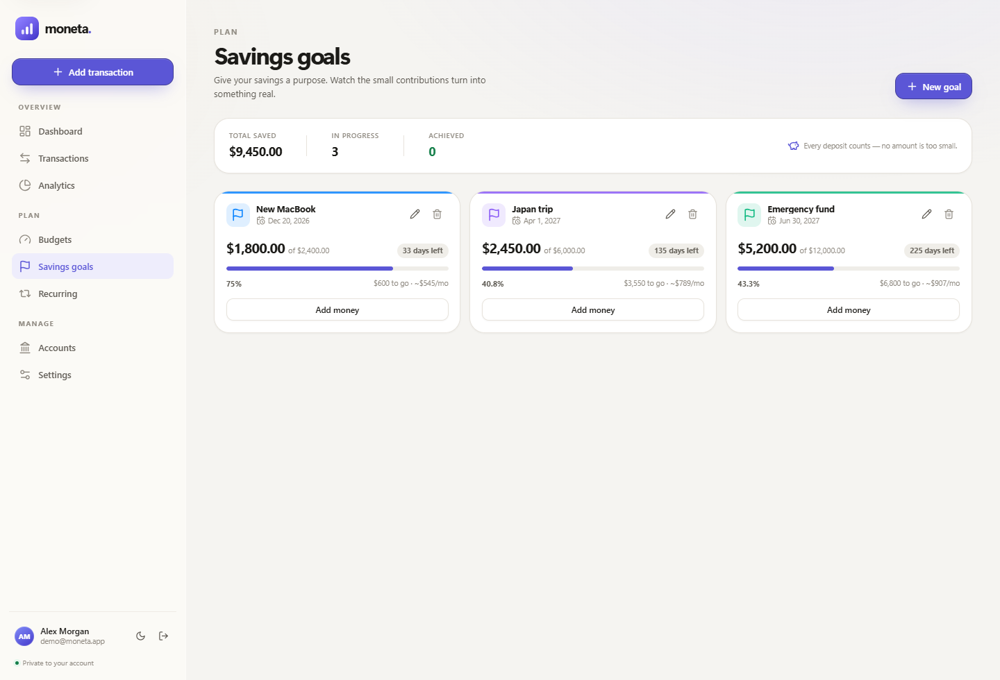
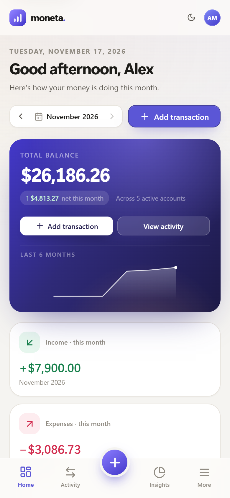
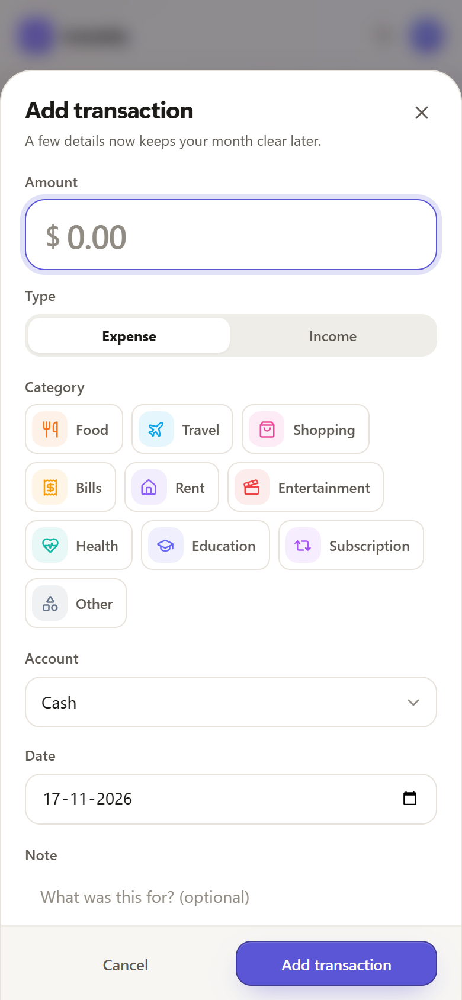

# Moneta — Web

React single-page app for **Moneta**, a personal expense tracker. State is
handled with the Context API (no Redux); all data comes from the Moneta API.

Live: <https://moneta-web-five.vercel.app> · API: <https://moneta-api-azure-ten.vercel.app>

Sign in with any registered account, or create one — registration seeds default
categories so the dashboard is immediately meaningful.

## Stack

React 18.3 · Vite 6 · React Router 6 · Recharts 2.15 · lucide-react · Vitest + Testing Library

## Screens



| Analytics | Budgets |
| --- | --- |
|  |  |

| Light | Dark |
| --- | --- |
|  |  |

| Accounts | Recurring | Goals |
| --- | --- | --- |
|  |  |  |

| Mobile dashboard | Add transaction |
| --- | --- |
|  |  |

## Features

- **Dashboard** — current balance, month income/expense, budget progress ring,
  savings-goal bars, a six-month cash-flow chart and recent activity.
- **Transactions** — paginated table with type/category/account filters,
  advanced date and amount ranges, debounced search, sorting, CSV export of the
  *filtered* set, and receipt attachment upload.
- **Analytics** — income-vs-expense trend and category breakdown across week /
  month / 3-month / year ranges, with period-over-period deltas.
- **Budgets** — overall and per-category limits that shift through
  on-track → watch → warning → near-limit → exceeded at 50 / 75 / 90 / 100 %.
- **Goals** — savings targets with contribution history and computed progress.
- **Recurring** — daily, weekly, monthly and yearly rules.
- **Accounts** — cash, bank, credit, wallet and savings, each with a derived
  balance; archived accounts stay out of pickers but keep their history.
- **Settings** — profile name and display currency, theme choice, a security
  overview of how the session and data isolation work, and sign-out.

## Getting started

```bash
npm install
npm run dev        # http://localhost:5173
```

With no `VITE_API_URL` set, Vite proxies `/api` to `http://localhost:5000`, so
running the API beside it needs no configuration. To point the app at a deployed
API instead, set `VITE_API_URL` — or, for same-origin cookies, leave it empty
and let the rewrite in `vercel.json` handle it.

## Tests

```bash
npm test           # 4 suites, 21 tests
```

Vitest + React Testing Library + user-event against a mocked API: the login
flow (validation, credential trimming, redirect, error surfacing), the
transaction table, the filter bar, and the add/edit modal including server
field-error mapping onto inputs.

## Design

The interface follows Apple's interface guidance, implemented in a hand-rolled
CSS design system rather than a component library:

- **Materials** — translucent `backdrop-filter` chrome with content scrolling
  beneath, a bright top edge to catch light, and blur/shadow scaled to surface
  size. Stacks resolve to near-solid where legibility would collapse.
- **Motion** — press feedback on pointer-down, spring-eased transform/opacity
  transitions on the compositor, and a short exit animation that keeps the
  dialog mounted while it leaves.
- **Typography** — the system SF Pro stack with optical tracking: negative
  letter-spacing that grows with size, tight leading on display text, and
  `tabular-nums` on money so figures align by column.
- **Adaptive preferences** — `prefers-color-scheme` and a manual override that
  persists; `prefers-reduced-transparency` and `prefers-contrast` flatten
  surfaces; charts read `prefers-reduced-motion` and skip animation.
- **Accessibility** — focus management and focus trapping in dialogs, `aria`
  on progress indicators, visible filter chips that clear individually, and
  chart data exposed as text (`role="img"` labels, or the donut's legend) so
  screen readers get the numbers rather than a picture.
- **States** — every list has deliberate loading, empty and error treatments;
  destructive actions are confirmed, and async failures toast without
  discarding the form a user was filling in.

## Project layout

```
src/
  api/         fetch wrapper, 401 broadcast, CSV and attachment download
  components/  layout, ui, and one folder per feature
  context/     Auth, AppData, Theme, Toast, UI
  hooks/       data fetching, debouncing, media queries
  lib/         constants, formatters, classnames
  pages/       one route per screen
  styles/      tokens, base, layout, components, pages
  test/        Vitest suites and setup
```

## Deployment

Built as static assets on Vercel. `vercel.json` rewrites `/api/:path*` to the
deployed API and `/(.*)` to `index.html`, which keeps requests same-origin so
the `httpOnly` session cookie is sent without a cross-site policy.
